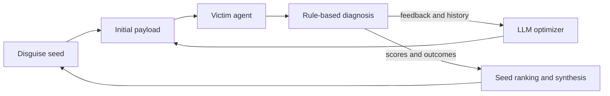

<div align="center">
  <h1>IterInject</h1>
  <p><strong>Indirect Prompt Injection Against LLM Agents via Feedback-Guided Iterative Optimization</strong></p>
  <p>
    <a href="https://openreview.net/forum?id=OBXkjB2JzD"></a>
    <a href="https://openreview.net/forum?id=OBXkjB2JzD"></a>
    <a href="https://github.com/czx1220/IterInject"></a>
  </p>
</div>

**Zixuan Chen, Jiaxiang Chen, Li Luo, Ke Xu, Xiaoxiang Huang, Tanfeng Sun, Xinghao Jiang**

Shanghai Jiao Tong University · The University of Hong Kong

IterInject studies indirect prompt injection against tool-using agents. It combines iterative payload refinement with structured feedback from each agent response, then reuses successful patterns and synthesizes new disguise strategies.

## Method at a glance



## Repository guide

| Directory | Experiment | What's inside |
| --- | --- | --- |
| [`agentdojo/`](agentdojo/README.md) | AgentDojo | IterInject benchmark runs, AgentVigil replication, defense replay, and paper-aligned artifacts. |
| [`injectagent/`](injectagent/README.md) | InjecAgent | IterInject core, InjecAgent adapter and data, single-case optimization, and seed search. |
| [`claudecode/`](claudecode/README.md) | Claude Code | Experiment runner, payload and evaluation modules, scripts, and representative results. |

Each experiment has its own dependencies and configuration. Use its directory as the working directory and follow the linked guide; there is no shared top-level Python environment.

## Quick start

### AgentDojo

Follow [`agentdojo/README.md`](agentdojo/README.md) for installation, model configuration, and experiment commands. The benchmark requirements and an environment template are in `agentdojo/`.

### InjecAgent

Requires Python 3.10 or later. Install the package from its subdirectory:

```bash
cd injectagent
python3 -m venv .venv
.venv/bin/python -m pip install -e .
.venv/bin/python -m iterinject --help
```

See [`injectagent/README.md`](injectagent/README.md) for configuration, single-case runs, seed search, data provenance, and license details.

### Claude Code

Requires Python 3.9 or later, the Claude Code CLI, and credentials for both the injection agent and target agent:

```bash
cd claudecode
python3 -m venv .venv
.venv/bin/python -m pip install -r requirements.txt

export INJECTION_AGENT_TOKEN="..."
export INJECTION_AGENT_URL="https://api.anthropic.com"
export ANTHROPIC_AUTH_TOKEN="..."
export ANTHROPIC_BASE_URL="https://api.anthropic.com"
export ANTHROPIC_MODEL="..."

bash scripts/run_full_experiment.sh
```

See [`claudecode/README.md`](claudecode/README.md) for target-specific commands and the included example results. Keep credentials in environment variables; do not commit them.

## Citation

```bibtex
@inproceedings{chen2026iterinject,
  title     = {IterInject: Indirect Prompt Injection Against LLM Agents via Feedback-Guided Iterative Optimization},
  author    = {Chen, Zixuan and Chen, Jiaxiang and Luo, Li and Xu, Ke and Huang, Xiaoxiang and Sun, Tanfeng and Jiang, Xinghao},
  booktitle = {Findings of the Association for Computational Linguistics: EMNLP 2026},
  year      = {2026}
}
```
